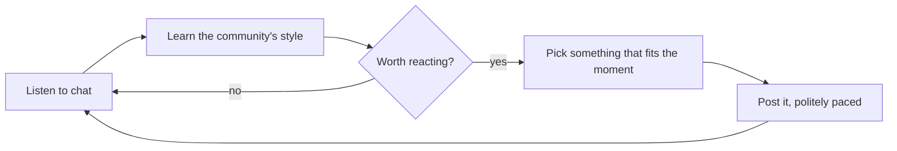

<div align="center">

# kick-chat-bot

**A friendly chat companion for Kick streams that learns how each community talks.**

[](https://github.com/MCantuncer/kick-chat-bot/actions/workflows/ci.yml)
[](https://www.python.org/)
[](https://github.com/astral-sh/uv)
[](https://github.com/astral-sh/ruff)
[](https://mypy-lang.org/)
[](https://hypothesis.works/)

</div>

---

## What it does

Every stream has its own culture: its nicknames, inside jokes, emotes and way of cheering. kick-chat-bot joins a channel's chat, listens first, and learns that culture. Once it gets the vibe, it joins in the way a regular would: reacting to the big plays, backing the streamer on a rough run, and using the chat's own words. It speaks rarely and never floods the chat.

## Highlights

- 👂 **Listens before it speaks.** Each new channel starts with a quiet learning phase.
- 🗣️ **Speaks the community's language.** It picks up the chat's language, slang and nicknames per channel.
- 🌱 **Keeps learning.** New jokes and phrases are picked up as the chat evolves.
- 🤏 **Low-key by design.** It speaks rarely and never floods the chat.
- 🛑 **Safe by default.** Built-in safety rules, an automatic pause and a kill switch.
- 💻 **Runs on your computer.** Start it when you want; it stops by itself when idle.
- 🔑 **No paid AI services.** Everything runs locally, so there are no API tokens to buy.

## How it works



## Getting started

> The project is in early development. Setup steps will be added here as features land.

Requirements: Python 3.12+ and [uv](https://docs.astral.sh/uv/).

```bash
git clone https://github.com/MCantuncer/kick-chat-bot.git
cd kick-chat-bot
make install
uv run kick-commenter --help
```

## Development

```bash
make check    # lint, type check and tests
make format   # auto-format and fix lint issues
```

See [CONTRIBUTING.md](CONTRIBUTING.md) for conventions.

## Status

🚧 Early development. Follow progress in the [issues](https://github.com/MCantuncer/kick-chat-bot/issues).
